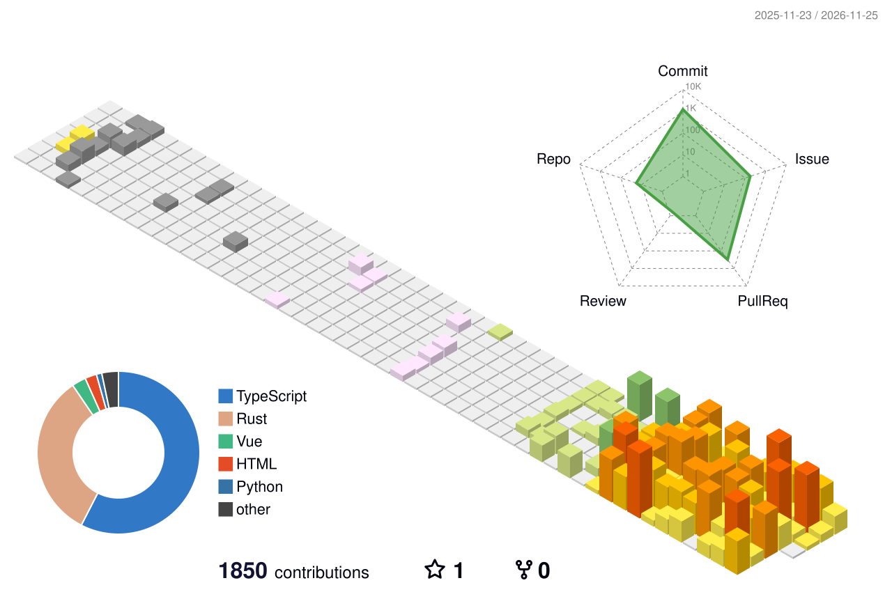

# 关于我 👋

> 充满鲜花的世界到底在哪里，如果它真的存在那么我一定会去。

你好，我是 **clearlove13**。

## 开源贡献 🧩

### 已合并

| 项目 | 工作 |
| --- | --- |
| MyGo [#1910](https://github.com/egoist/mygo/pull/1910) | 修复单实例锁的生命周期与并发启动问题；持续等待锁释放、兼容旧版实例的改进由上游整合至 #1909，以 Co-author 身份合入 main（#1910 因方案重叠关闭）。 |
| Raven [#1309](https://github.com/EverMind-AI/Raven/pull/1309) / [#1321](https://github.com/EverMind-AI/Raven/pull/1321) | 头部摘要压缩不再吞掉只存在于旧消息里的插件 MCP notice：摘要成功后在当前问题重述最新生效的 notice，逐字尾部保证从本轮 runtime-context 问题信封之前起算；生成的参与者收到的 tool call 改投影成纯 `id`/`name`/`arguments` 映射，不再被序列化成 dataclass 字符串。 |
| [teamai-cli #996](https://github.com/Tencent/teamai-cli/pull/996) | 代码图谱补上 Scala：采集器白名单 `.scala` 并标记 `Main.scala`/`App.scala` 为关键文件，新增 Scala 抽取器，Java/Scala 混合项目不再产出只含 Java 的图。 |
| [3x-ui #6830](https://github.com/MHSanaei/3x-ui/pull/6830) | `XUI_ENABLE_FAIL2BAN=false` 不再导致客户端 IP 停止记录：env 变量只门控封禁执行，扫描与在线统计照常入库，Windows 路径同样停用。 |
| [Aion #6](https://github.com/Games55k/Aion/pull/6) | 修复自动保存后的导航与退出清理：放弃修改后关闭详情或切页，后一次保存请求会被吞掉并在无关保存时触发；改为当前写入结束后执行并清除该次请求，保存中的任务不被移入回收站，退出与进程清理共用一次保存收尾与数据库关闭。 |

### 待合并

| 项目 | 工作 |
| --- | --- |
| [MyGo #1970](https://github.com/egoist/mygo/pull/1970) | `.view` 标记文件编译成普通 `View(c *ui.Context)` Go 方法（#1457 第一阶段）：UI 树进标记、状态与逻辑留在 Go；从应用 `ui` export data 读取构造器与事件查询，`go/types` 解析名字，写盘前逐个类型检查候选输出，`mygo generate` 与 CLI 编译前自动运行。 |
| [FreeSWITCH #3203](https://github.com/signalwire/freeswitch/pull/3203) | v1.11.2 引入的 inject-DoS 防护误吞了 `switch_rtp_break()` 唤醒读线程的 break ping，无 timer 的 RTP 会话挂断延迟从 ~20ms 涨到 ~5s；修正判据让该 ping 直通。 |
| [nats.go #2255](https://github.com/nats-io/nats.go/pull/2255) | `Conn.Flush()`/`RTT()` 和 `Drain()` 收尾 flush 的等待原本是写死的 10s / 5s 魔数（#580）；新增 `FlushWait` 与 `DrainFlushTimeout` 选项，默认值不变、拨号时拒绝负值，订阅 drain 的确认固定用默认等待而不跟随偏短的 `FlushWait`，避免队列里的消息被提前丢弃，并补上超时选择与订阅 drain 的回归测试。 |
| [River #1604](https://github.com/riverqueue/river/pull/1604) | 给 `JobCompleteTx` 事务完成示例补一个可运行的 worker 测试：worker 的数据库字段改成只含 `Begin(ctx) (pgx.Tx, error)` 的接口，生产示例从连接池开事务，测试用 `rivertest.Worker` 把外层测试事务注入同一个 worker、经保存点访问未提交的任务；在 worker 返回前断言任务已变为 `completed`，避免自动完成掩盖 `JobCompleteTx` 未生效。 |

## 最近文章 ✍️

<!-- BLOG-POST-LIST:START -->
- [Claude 的记忆系统：显著性、做梦，和 MEMORY.md 的前 200 行](https://yudongyouqing.github.io/2026/11/16/claude-memory-takeaways/)
- [GoFrame 数组参数静默绑定失败：比不支持更坑的半吊子支持](https://yudongyouqing.github.io/2026/10/20/goframe-indexed-array-binding/)
- [Go 语言中的 defer：常见用法与避坑指南](https://yudongyouqing.github.io/2026/10/20/go-defer/)
- [一个流水水水水账](https://yudongyouqing.github.io/2026/06/16/yi-ge-liu-shui-shui-shui-zhang/)
- [中文分词-最大匹配算法](https://yudongyouqing.github.io/2026/06/04/%E4%B8%AD%E6%96%87%E5%88%86%E8%AF%8D-%E6%9C%80%E5%A4%A7%E5%8C%B9%E9%85%8D%E7%AE%97%E6%B3%95/)
<!-- BLOG-POST-LIST:END -->

## 活跃度 📈

